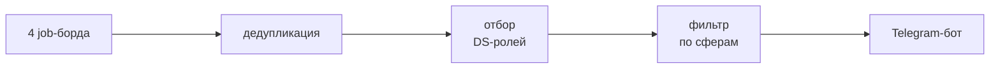

# Data Science Jobs Radar


Telegram-бот для поиска работы в data science. Каждые 4 часа собирает вакансии
с четырех job-бордов, убирает дубли, отбирает DS / ML-роли в нужных сферах
и присылает подписчику только новые. Сферы (16, от fintech до healthtech) и роли (12)
каждый выбирает кнопками в боте.

За неделю в начале октября 2026: **1383 вакансии → 1312 после дедупликации →
82 с DS-ролью → 63 в целевых сферах**. Вместо полутора тысяч объявлений —
шесть десятков, которые стоит открыть.

## Качество

Отбор и дедупликация работают на правилах, поэтому качество проверяется на ручной
разметке, а не по ощущениям от сводки. Правила дорабатывались по ошибкам на одной
неделе вакансий (dev), а итоговые цифры сняты на следующей — ее правила не видели (test).

| Задача | Разметка | Наивный baseline | Проект |
|---|---|---|---|
| Отбор DS-ролей · test | 1739 вакансий, 139 DS | P 0.55 · R 0.83 | **P 0.98 · R 0.64** |
| Отбор DS-ролей · dev | 374 вакансии, 80 DS | P 0.80 · R 0.71 | P 1.00 · R 0.90 |
| Дедупликация · dev | 232 пары | P 0.90 · R 0.38 | P 0.98 · R 0.90 |

- **Точность переносится на новую неделю, полнота — нет.** Бот почти не присылает
  лишнего, но пропускает треть DS-вакансий: правила выучили словарь dev-недели.
  21 из 50 пропусков — хранилища данных (DWH, КХД, ETL, Greenplum), 16 — руководящие
  роли («тимлид DS», «Head of Analytics», «Team Lead Data & AI»).
- **Разметка проверена на согласие с собой.** 50 вакансий из dev вслепую размечены
  второй раз: по роли kappa = 1.00, сферы совпали в 96%, а роли в 80%, это самая
- неоднозначная часть задачи.

Методология, интервалы и все версии правил — в [`eval/`](eval/README.md).

## Как устроено



- **Источники:** getmatch через json api, остальные — html-парсинг. Все отдают
  вакансии в едином формате, падение одного источника не останавливает прогон.
- **Хранение:** SQLite — сырые вакансии, прогоны пайплайна, подписчики, журнал отправок.
- **Бот:** long polling. Новые для подписчика вакансии определяются по журналу
  отправок с учетом дублей с других бордов.

Инженерная часть: 105 unit-тестов без сети, CI в GitHub Actions (pre-commit
с ruff + pytest на каждый push), деплой на Ubuntu как systemd-служба
от непривилегированного пользователя.

**Стек:** Python 3.12, pandas, requests, BeautifulSoup, APScheduler, SQLite,
pytest, ruff, pre-commit, GitHub Actions.

## Запуск

```bash
pip install -r requirements.txt
python main.py   # первый прогон сразу, дальше — каждые 4 часа
```

Перед запуском нужен `.env` в корне с токеном от BotFather: `TELEGRAM_BOT_TOKEN=...`.
На сервере: `bash setup.sh` один раз, затем `bash update.sh` после изменений в `main`
(оба от root). Для разработки: `pip install -r requirements-dev.txt`, `pre-commit install`,
тесты — `pytest`.

## Структура

```
sources/    парсеры job-бордов
pipeline/   нормализация, дедупликация, классификация, статистика
storage/    SQLite
bot/        Telegram-бот: команды, фильтры, рассылка
eval/       разметка и оценка качества
tests/      unit-тесты
```

## Roadmap

- [ ] докеризация
- [ ] логирование
- [ ] выбор грейда в боте
- [ ] расчет статистики зарплат по ролям и грейдам
- [ ] дополнительные джоб-борды
